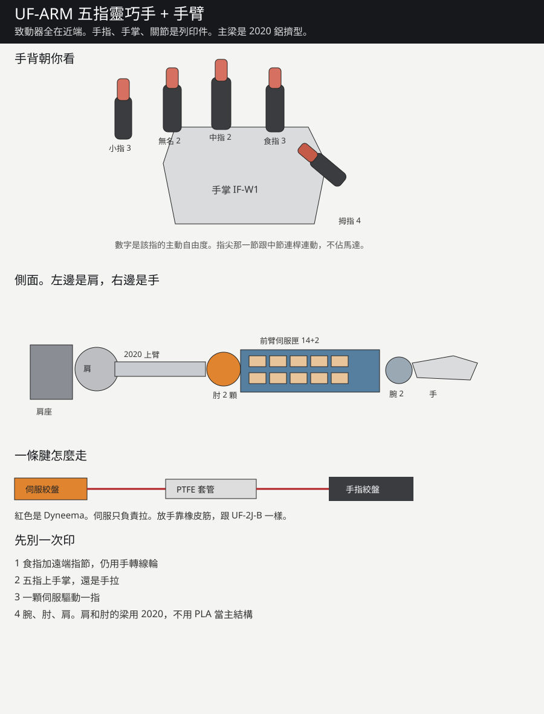

# UF-ARM

五指靈巧手加手臂。致動器全在近端。手指沿用 UF-2J-B。

模型檔還在 [uf-2j-b](https://github.com/slhuang0221-cell/uf-2j-b)。這一頁是整機架構，不是一次可印的整臂。

## 自由度

| 部位 | 主動自由度 | 伺服數量 | 說明 |
|---|---|---|---|
| 食指、小指 | 3 | 各 3 | 外展、掌指彎、近端指節彎 |
| 中指、無名指 | 2 | 各 2 | 不主動外展 |
| 拇指 | 4 | 4 | 對掌、腕掌彎、掌指、指節 |
| 腕 | 2 | 2 | 俯仰、偏擺，差動 |
| 肘 | 1 | 2 顆並聯 | GT2 20:60 |
| 肩屈伸 | 1 | 3 顆並聯 | GT2 20:80 |
| 肩外展 | 1 | 2 顆並聯 | GT2 20:80 |
| 合計 | 19 | 23 | 上臂旋轉下一級才做 |

遠端指節用連桿跟近端指節連動，不占伺服。

## 通用件

- 伺服：Feetech STS3215，7.4 V，外殼 45.2 × 24.7 × 35 mm，約 55 g，25T 齒
- 主梁：2020 鋁擠型，上臂 180 mm，前臂只做導軌，伺服匣是列印件
- 軸承：肘、肩用 625ZZ（5×16×5）。手指暫不裝軸承
- 腱：0.8 mm Dyneema。套管：PTFE 內徑 2 mm、外徑 3 mm
- 皮帶：GT2，寬 6 mm。輪：20 齒對 60 齒（肘）、20 齒對 80 齒（肩）
- 螺絲：M3。熱熔銅螺母 M3×5×4。限位銷用 1.75 mm 線材
- 電源：7.4 V、15 A 檮面電源。先不要把電池綁在手臂上

## 介面

- IF-A1：手指根，2×M3 + 2×Ø3.2 銷，沿用 UF-2J-B
- IF-W1：手掌對手腕，4×M4，節圓 48 mm，中央留 Ø16 讓套管束通過
- IF-S1：手臂段，4×M4，節圓 40 mm，對到 2020 端面
- IF-D1：伺服匣一格。拆一顆伺服不用拆整條前臂

## 列印

PLA，0.4 mm 噴嘴，牆厚至少 2.4 mm，活動間隙 0.4 mm。手指沿用 UF-2J-B 的平放列印。前臂匣分成兩段，每段短於 160 mm。
